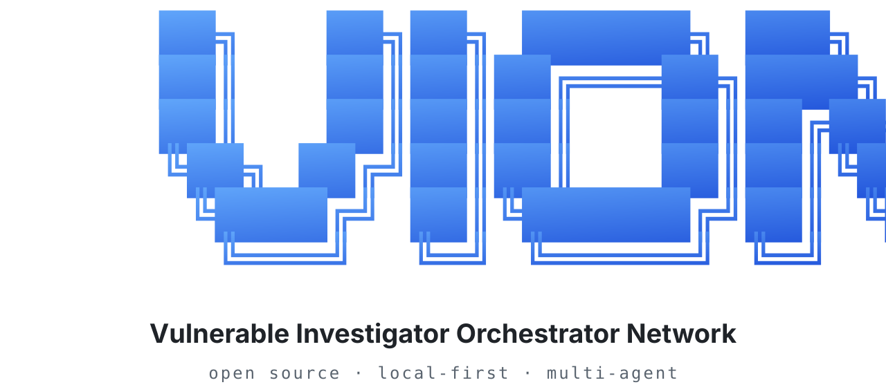
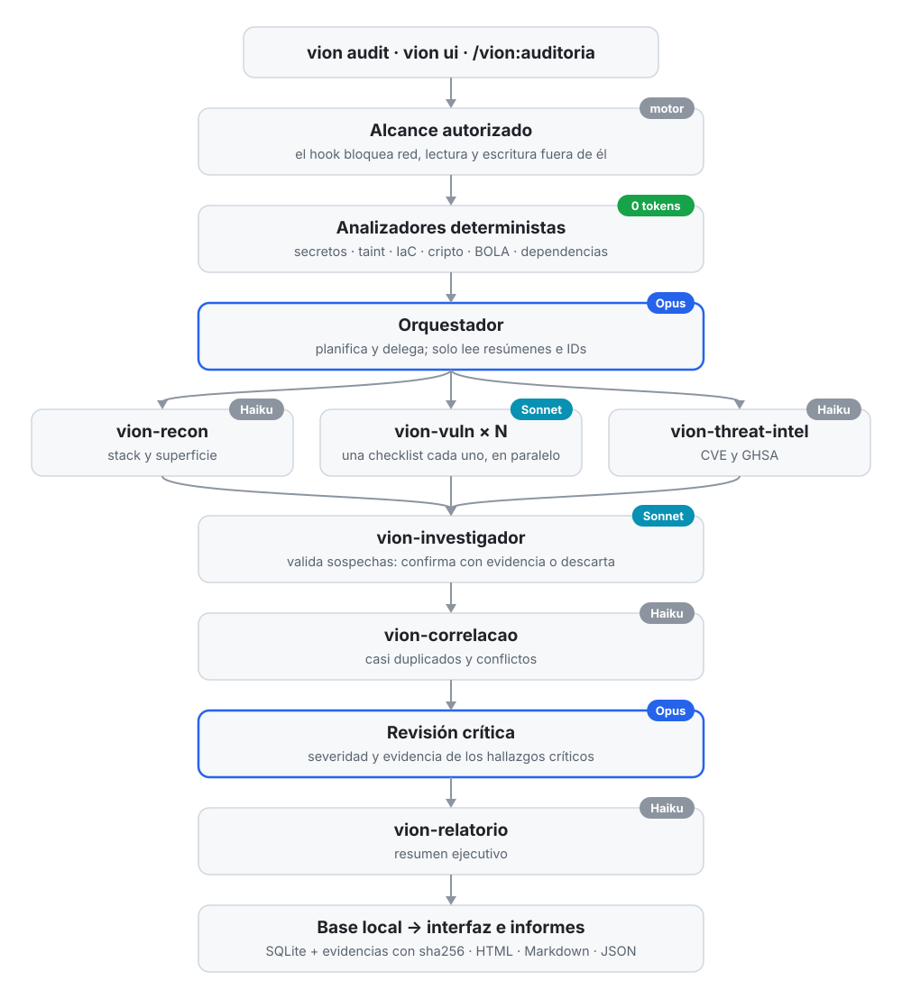

<p align="center">
  <picture>
    <source media="(prefers-color-scheme: dark)" srcset="docs/assets/vion-banner-dark.svg">
    
  </picture>
</p>

<p align="center">
  <a href="README.md">English</a> · <a href="README.pt-BR.md">Português</a> · <b>Español</b>
</p>

# VION Security Agent

### Vulnerable Investigator Orchestrator Network

**Open-source security agent for AI-assisted development, autonomous auditing and evidence-driven vulnerability investigation.**

---

## Instalación

### Requisitos

| Requisito | Versión o condición |
|---|---|
| Node.js | 22.13 o superior |
| Claude Code | Instalado y autenticado |
| Sistema operativo | Windows, macOS o Linux |

### Instalación con npm

```bash
npm install -g @vionsec/cli
vion init
```

### Instalación directa desde GitHub

```bash
npm install -g github:jvncodez/VionSecurityAgent
vion init
```

El comando de inicialización configura la integración de VION con Claude Code, incluidas las skills, los subagentes, el servidor MCP y el hook que aplica el alcance.

Después de la instalación, reinicia Claude Code y ejecuta:

```bash
vion doctor
```

El diagnóstico verifica los componentes necesarios para la ejecución.

### Desinstalación

```bash
vion uninstall
```

Consulta la documentación del comando antes de eliminar componentes o datos que quieras conservar.

---

## Primeros pasos

VION ofrece tres formas principales de iniciar una auditoría.

### 1. Interfaz local

```bash
vion ui
```

La interfaz está disponible en:

`http://localhost:3333`

Entra en la sección de auditorías para seleccionar un proyecto, definir el alcance autorizado y seguir la ejecución de los agentes.

Para usar otro puerto:

```bash
vion ui --port 4000
```

### 2. Terminal

```bash
cd mi-proyecto

# Auditoría completa con múltiples agentes
vion audit .

# Solo analizadores deterministas
vion audit . --analyzers-only

# Ejecutar una skill específica
vion audit . --skills unified-scan

# Definir un límite de costo
vion audit . --max-cost 2
```

El modo `--analyzers-only` ejecuta los analizadores compatibles sin usar tokens de modelos de IA.

### 3. Claude Code

Dentro de Claude Code, ejecuta:

```text
/vion:auditoria
```

La skill inicia el flujo de auditoría integrado al proyecto.

### Consultar resultados

```bash
vion audit history
vion audit status <id>
vion report <id> --format html
```

La referencia completa de argumentos y opciones está en [`docs/COMMANDS.md`](docs/COMMANDS.md).

---

## Sobre el proyecto

VION Security Agent es un agente autónomo de seguridad que coordina una red jerárquica de agentes especializados para analizar aplicaciones, investigar vulnerabilidades y producir informes basados en evidencias.

El proyecto nació de una investigación sobre la seguridad de las aplicaciones desarrolladas con inteligencia artificial, especialmente los riesgos que surgen cuando la velocidad de generación de código se prioriza sobre la validación de seguridad.

El objetivo es acercar la velocidad del desarrollo asistido por IA al rigor que exige la ingeniería de seguridad.

- **Open source:** licencia MIT.
- **Runtime:** Node.js 22.13+.
- **Integración:** Claude Code.
- **Arquitectura:** orquestador, subagentes especializados y analizadores deterministas.
- **Privacidad:** ejecución local-first, con la base de datos y las evidencias almacenadas localmente.
- **Validación:** una vulnerabilidad solo se considera confirmada cuando tiene evidencia y un método de validación registrados.

## El problema que estamos investigando

La inteligencia artificial hizo posible desarrollar aplicaciones a una velocidad que antes requería equipos enteros. Sin embargo, generar código funcional no significa necesariamente construir software seguro.

En nuestra investigación, estudiamos cómo los agentes de IA manejan los requisitos de seguridad, la validación de código y las vulnerabilidades recurrentes del OWASP Top 10.

Identificamos un problema importante: las aplicaciones pueden parecer completas y funcionar correctamente, pero aun así presentar fallas de autorización, exposición de datos, configuraciones inseguras y problemas en la implementación de sus APIs.

Entre los ejemplos que motivaron el proyecto están:

- IDOR y otras fallas de control de acceso.
- Exposición indebida de datos e información sensible.
- APIs con permisos o configuraciones inadecuados.
- Secretos incrustados en el código fuente.
- Fallas de autenticación y de gestión de sesiones.
- Vulnerabilidades en dependencias y en la configuración de infraestructura.
- Problemas de seguridad propios de las aplicaciones que usan LLMs.

El resultado puede ser una aplicación construida rápidamente, pero que requiere meses de investigación, correcciones y refactorización para alcanzar un nivel adecuado de seguridad.

**VION fue desarrollado para investigar este cuello de botella.**

En lugar de tratar la seguridad como una etapa aislada al final del proyecto, proponemos incorporarla al ciclo de vida del software: desde la arquitectura y la implementación hasta la auditoría, la preproducción y el post-despliegue.

## Nuestro enfoque

### Desarrollo seguro desde el inicio

VION fue concebido para apoyar un desarrollo seguro desde la primera línea de código.

Esto implica identificar riesgos antes de la implementación, orientar las decisiones de arquitectura, verificar los controles de seguridad durante el desarrollo y auditar la aplicación antes y después de su despliegue.

El agente también puede ayudar a preparar configuraciones básicas de infraestructura, incluidos entornos en Virtual Private Servers (VPS), según el alcance y las necesidades del proyecto.

La propuesta no es reemplazar a desarrolladores, ingenieros de seguridad ni procesos de QA. Es ofrecer una capa adicional de análisis e investigación que ayude a reducir fallas evitables.

## La investigación

La pregunta principal de la investigación es:

> ¿Puede una red jerárquica de agentes de IA auditar software con rigor, evidencias verificables y un menor consumo de tokens que un enfoque basado en un solo agente?

La arquitectura actual explora tres hipótesis.

**1. Análisis determinista antes del análisis por IA**

Los analizadores estáticos verifican patrones conocidos, como secretos expuestos, flujos de datos potencialmente peligrosos, configuraciones de infraestructura, uso de criptografía y posibles fallas de autorización.

Estas verificaciones no dependen de tokens de modelos de lenguaje y ayudan a reservar el análisis por IA para las tareas que requieren más contexto.

**2. Especialización y jerarquía de agentes**

Un modelo de mayor capacidad planifica la auditoría, distribuye las tareas y revisa los resultados. Subagentes especializados ejecutan checklists de seguridad en paralelo e investigan distintas partes de la aplicación.

Esta división busca reducir el contexto redundante y hacer el proceso más eficiente.

**3. Evidencia obligatoria para la confirmación**

Todo hallazgo comienza como sospecha. Para ser confirmado, debe tener una evidencia asociada y un método de validación documentado.

Cuando la evidencia no es suficiente, el hallazgo no debe presentarse como vulnerabilidad confirmada.

### Resultado experimental

En una auditoría de un proyecto de prueba deliberadamente vulnerable, la configuración experimental confirmó 13 hallazgos con evidencias en aproximadamente 3,5 minutos, con un costo reportado de US$ 0,89.

En esa ejecución, el orquestador basado en Opus representó aproximadamente el 55% del costo, y los subagentes, el resto.

Estas cifras describen una ejecución específica, no una garantía de rendimiento, cobertura ni costo para cualquier aplicación. La investigación busca ampliar la validación a distintos proyectos y escenarios.

---

## Cómo funciona

VION combina análisis determinista, planificación, investigación en paralelo, validación de evidencias, correlación de resultados y generación de informes.

El flujo general es:

1. El usuario inicia una auditoría desde la CLI, la interfaz local o Claude Code.
2. El motor verifica el alcance y los permisos aplicables.
3. Los analizadores deterministas ejecutan las verificaciones compatibles.
4. El orquestador divide el trabajo entre los agentes especializados.
5. Los subagentes investigan distintas categorías de vulnerabilidades.
6. El agente investigador valida las sospechas y registra las evidencias.
7. El motor correlaciona los resultados y trata los duplicados.
8. El orquestador realiza la revisión final.
9. El agente de informes organiza los resultados para el análisis técnico y ejecutivo.

<p align="center">
  <picture>
    <source media="(prefers-color-scheme: dark)" srcset="docs/assets/vion-flow-es-dark.svg">
    
  </picture>
</p>

Los resultados se almacenan localmente y pueden consultarse en la interfaz o exportarse en formatos como HTML, Markdown y JSON.

### Agentes especializados

| Agente | Responsabilidad |
|---|---|
| Orquestador | Planifica, delega tareas y revisa los resultados críticos. |
| `vion-recon` | Identifica el stack tecnológico, los activos y la superficie de ataque. |
| `vion-vuln` | Ejecuta checklists especializadas de vulnerabilidades. |
| `vion-threat-intel` | Investiga dependencias, CVEs y avisos GHSA. |
| `vion-investigador` | Evalúa sospechas, evidencias y métodos de validación. |
| `vion-correlacao` | Identifica duplicados y conflictos entre hallazgos. |
| `vion-relatorio` | Produce el resumen ejecutivo y organiza los resultados. |

Los modelos asociados a cada función son configurables. La configuración predeterminada usa Opus en el orquestador, Sonnet en las tareas de investigación y Haiku en las funciones auxiliares.

### Ciclo de vida de los hallazgos

`Sospechoso → Confirmado`

`Sospechoso → Falso positivo`

La confirmación exige evidencia y un método de validación documentado. Un resultado sin evidencia suficiente permanece sin confirmar, independientemente de la confianza que exprese el modelo.

### Eficiencia de contexto y costos

La arquitectura busca reducir el consumo de tokens mediante:

- La división de las tareas en checklists especializadas.
- El intercambio de identificadores de auditoría y de tareas a través de MCP.
- El uso de resúmenes e identificadores de hallazgos en lugar de grandes bloques de código en el contexto del orquestador.
- La deduplicación de hallazgos por huella digital.
- Límites de costo configurables que detienen la ejecución.

La eficiencia depende del proyecto, de los modelos utilizados, de la cantidad de código analizado y de las tareas necesarias.

---

## Comandos

VION usa `vion help` como punto central de consulta de la documentación de la CLI.

```bash
vion help
vion help audit
```

La ayuda general muestra los comandos disponibles. La ayuda específica detalla el uso, las opciones y los ejemplos del comando solicitado.

| Comando | Finalidad |
|---|---|
| `vion help` | Muestra la ayuda general de la CLI. |
| `vion help <comando>` | Muestra la documentación de un comando específico. |
| `vion init` | Instala y configura la integración con Claude Code. |
| `vion ui` | Inicia la interfaz web local. |
| `vion audit <objetivo>` | Inicia una auditoría autorizada. |
| `vion audit history` | Lista las auditorías anteriores. |
| `vion audit status <id>` | Consulta el progreso y los costos de una auditoría. |
| `vion report <id>` | Genera o exporta un informe. |
| `vion agents list` | Lista los agentes y sus modelos configurados. |
| `vion skills list` | Lista las skills disponibles. |
| `vion skills show <nombre>` | Explica una skill y sus requisitos. |
| `vion config get` | Consulta la configuración. |
| `vion config set <clave> <valor>` | Cambia una configuración compatible. |
| `vion doctor` | Diagnostica la instalación. |
| `vion data backup` | Crea una copia de seguridad de los datos locales. |
| `vion data export <id>` | Exporta los datos de una auditoría. |
| `vion data prune` | Elimina datos según los criterios configurados. |
| `vion uninstall` | Elimina la integración instalada por VION. |

Para los argumentos exactos, las opciones adicionales y los ejemplos de uso, consulta `vion help` y la documentación correspondiente.

---

## Skills de VION

Las skills especializan el comportamiento del agente según la tarea. Cada una tiene una finalidad clara, criterios de uso y permisos acordes con su responsabilidad.

| Categoría | Skills |
|---|---|
| Orientación | `/vion`, `/vion:ajuda`, `/vion:ciclo` |
| Desarrollo seguro | `/vion:novo`, `/vion:dev-seguro` |
| Auditoría | `/vion:auditoria`, `/vion:orquestrar`, `/vion:unified-scan` |
| Pentest y corrección | `/vion:pentester`, `/vion:pentest`, `/vion:corrigir`, `/vion:fixes` |
| Aprendizaje y diagnóstico | `/vion:ensinar`, `/vion:debug` |
| Reconocimiento e inteligencia | `/vion:recon`, `/vion:supply-chain` |
| Seguridad de IA | `/vion:ai` |
| Preproducción y operación | `/vion:pre-deploy`, `/vion:monitorar`, `/vion:incidente` |
| Privacidad | `/vion:lgpd` |
| Utilidades | `/vion:landing`, `/vion:status` |

Para entender una skill, ejecuta:

```bash
vion skills show <nombre>
```

Muestra el propósito de la skill, los escenarios de uso, los agentes involucrados y los permisos necesarios.

---

## Interfaz web local

La interfaz permite seguir el ciclo de vida de las auditorías sin depender exclusivamente de la terminal.

| Página | Funcionalidad |
|---|---|
| Inicio | Indicadores, severidades y auditorías recientes. |
| Auditorías | Creación, seguimiento e interrupción de las ejecuciones. |
| Agentes | Actividades, modelos, tokens, costos y duración. |
| Vulnerabilidades | Triaje de los hallazgos sospechosos, confirmados y descartados. |
| Evidencias | Fragmentos de código y resultados que respaldan los hallazgos. |
| Informes | Exportación en HTML, Markdown y JSON. |
| Skills y configuración | Consulta de las skills, los modelos y los límites operativos. |

Las evidencias pueden incluir hashes de integridad para ayudar a detectar alteraciones posteriores.

La interfaz está pensada para acceso local y no tiene un sistema de login propio. Por eso, no debe exponerse a otras máquinas.

---

## Seguridad y uso responsable

VION está destinado a la auditoría y la investigación de seguridad en proyectos propios o en sistemas para los que exista la autorización adecuada.

### Controles previstos en la arquitectura

- **Alcance:** el motor aplica las restricciones de la auditoría, con apoyo de hooks y verificaciones de permisos.
- **Pruebas activas:** exigen autorización y un alcance compatibles con las operaciones ejecutadas.
- **Lectura y escritura:** las operaciones se limitan según el modo de ejecución y los permisos definidos.
- **Protección de secretos:** los tokens y las contraseñas se enmascaran antes de almacenarse o incluirse en los informes.
- **Aislamiento local:** la interfaz permanece vinculada a `127.0.0.1`, con protecciones contra los ataques aplicables a un servidor web local.
- **Instrucciones maliciosas en el código:** el contenido encontrado durante la auditoría se trata como dato no confiable, nunca como instrucción para los agentes.

La efectividad de estos controles depende de su implementación y validación. Consulta [`SECURITY.md`](SECURITY.md) para conocer el modelo de amenazas, las limitaciones y el procedimiento de divulgación responsable.

---

## Privacidad y almacenamiento

VION usa almacenamiento local para mantener el historial de auditorías, las evidencias, los informes, los logs y la configuración.

| Sistema | Directorio predeterminado |
|---|---|
| Windows | `%LOCALAPPDATA%\vion` |
| macOS | `~/Library/Application Support/vion` |
| Linux | `$XDG_DATA_HOME/vion` o `~/.local/share/vion` |

La variable `VION_HOME` permite usar otro directorio de almacenamiento.

Ejemplos:

```bash
# Crear una copia de seguridad
vion data backup

# Exportar una auditoría
vion data export <id>

# Eliminar auditorías antiguas
vion data prune --older-than 90

# Configurar la retención
vion config set retention.days 180
```

El proyecto fue concebido para no enviar datos a servidores propios. Las funciones de IA dependen de la integración con Claude Code y del procesamiento realizado por el proveedor del modelo utilizado. Por lo tanto, el almacenamiento local no significa que el código nunca se transmita a servicios externos durante un análisis con IA.

Los analizadores deterministas pueden funcionar sin llamadas a modelos de lenguaje. Consulta la documentación para conocer los requisitos de conectividad y las condiciones de privacidad de cada modo.

---

## Contribuir

VION es un proyecto open source de investigación e ingeniería de seguridad. Las contribuciones son bienvenidas para ampliar la cobertura del análisis, mejorar la precisión de las investigaciones y hacer la arquitectura más eficiente.

Algunos puntos de partida:

- `assets/checklists/`: nuevas checklists y mejoras de cobertura.
- `assets/skills/`: nuevas skills y mejoras en las existentes.
- `src/analyzers/`: analizadores deterministas.
- Agentes y orquestación: mejoras de especialización, validación y consumo de contexto.
- Pruebas: proyectos de referencia, casos reproducibles y evaluación de falsos positivos.

Antes de contribuir, consulta [`CONTRIBUTING.md`](CONTRIBUTING.md).

Las fallas de seguridad en el propio VION deben reportarse de forma privada, según las instrucciones de [`SECURITY.md`](SECURITY.md).

Repositorio: [github.com/jvncodez/VionSecurityAgent](https://github.com/jvncodez/VionSecurityAgent)

## Licencia

VION Security Agent se distribuye bajo la licencia MIT. Consulta el archivo [`LICENSE`](LICENSE) para conocer los términos de uso, modificación y redistribución.

Usa la herramienta solo en entornos propios o con la autorización adecuada.

---

<p align="center">
  <b>VION Security Agent</b><br>
  <b>Build faster. Investigate deeper. Develop securely.</b><br>
  Un proyecto open source dedicado a la investigación de agentes autónomos de seguridad, la validación basada en evidencias y el desarrollo seguro de aplicaciones con inteligencia artificial.
</p>
