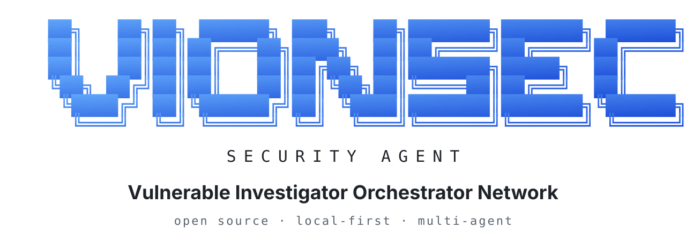
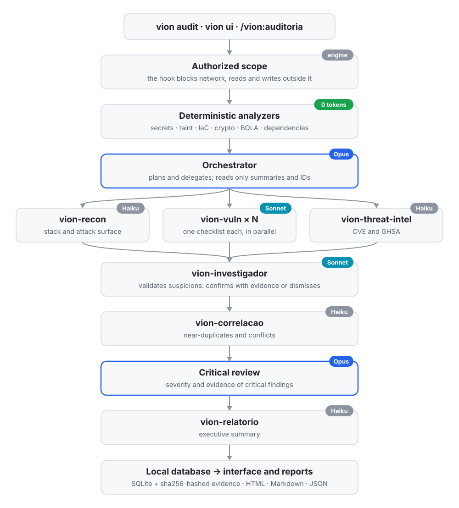

<p align="center">
  <picture>
    <source media="(prefers-color-scheme: dark)" srcset="docs/assets/vion-banner-en-dark.svg">
    
  </picture>
</p>

<p align="center">
  <b>English</b> · <a href="docs/README.pt-BR.md">Português</a> · <a href="docs/README.es.md">Español</a>
</p>

# VION Security Agent

### Vulnerable Investigator Orchestrator Network

**Open-source security agent for AI-assisted development, autonomous auditing and evidence-driven vulnerability investigation.**

> **Note:** VION is a research tool that supports security work. It does not replace qualified professionals such as pentesters, security analysts and auditors. Its findings must be reviewed by people with security expertise before any decision is made.

---

## Installation

### Requirements

| Requirement | Version or condition |
|---|---|
| Node.js | 22.13 or later |
| Claude Code | Installed and authenticated |
| Operating system | Windows, macOS or Linux |

VION currently runs on Claude Code. Support for other agent platforms, such as Cursor and OpenCode, is planned (see [Roadmap](#roadmap)).

### Install from npm

```bash
npm install -g @vionsec/cli
vion init
```

### Install directly from GitHub

```bash
npm install -g github:jvncodez/VionSecurityAgent
vion init
```

The initialization command sets up VION's integration with Claude Code, including the skills, the subagents, the MCP server and the scope enforcement hook.

After installing, restart Claude Code and run:

```bash
vion doctor
```

The diagnostic checks every component required to run VION.

### Uninstall

```bash
vion uninstall
```

Read the command's documentation before removing components or data you want to keep.

---

## Getting started

VION offers three main ways to start an audit.

### 1. Local interface

```bash
vion ui
```

The interface is available at:

`http://localhost:3333`

Open the audits section to select a project, define the authorized scope and follow the agents as they work.

To use a different port:

```bash
vion ui --port 4000
```

### 2. Terminal

```bash
cd my-project

# Full multi-agent audit
vion audit .

# Deterministic analyzers only
vion audit . --analyzers-only

# Run a specific skill
vion audit . --skills unified-scan

# Set a cost limit
vion audit . --max-cost 2
```

The `--analyzers-only` mode runs the supported analyzers without spending AI model tokens.

### 3. Claude Code

Inside Claude Code, run:

```text
/vion:auditoria
```

The skill starts the audit flow integrated with the project.

### Review results

```bash
vion audit history
vion audit status <id>
vion report <id> --format html
```

The full reference of arguments and options is in [`docs/COMMANDS.md`](docs/COMMANDS.md).

---

## About the project

VION Security Agent is an autonomous security agent that coordinates a hierarchical network of specialized agents to analyze applications, investigate vulnerabilities and produce evidence-based reports.

The project grew out of research on the security of applications built with artificial intelligence, especially the risks introduced when the speed of code generation takes priority over security validation.

The goal is to bring the speed of AI-assisted development closer to the rigor that security engineering demands.

- **Open source:** MIT license.
- **Runtime:** Node.js 22.13+.
- **Integration:** Claude Code.
- **Architecture:** an orchestrator, specialized subagents and deterministic analyzers.
- **Privacy:** local-first execution, with the database and evidence stored locally.
- **Validation:** a vulnerability is only considered confirmed when it has recorded evidence and a validation method.

## The problem we are investigating

Artificial intelligence has made it possible to build applications at a speed that used to require entire teams. However, generating working code does not necessarily mean building secure software.

In our research, we studied how AI agents handle security requirements, code validation and the recurring vulnerabilities of the OWASP Top 10.

We identified an important problem: applications can look complete and work correctly while still having authorization flaws, data exposure, insecure configurations and problems in their API implementations.

Examples that motivated the project include:

- IDOR and other access control failures.
- Improper exposure of data and sensitive information.
- APIs with inadequate permissions or configurations.
- Secrets embedded in source code.
- Authentication and session management failures.
- Vulnerabilities in dependencies and infrastructure configuration.
- Security problems specific to applications that use LLMs.

The result can be an application that was built quickly but requires months of investigation, fixes and refactoring to reach an adequate level of security.

**VION was built to investigate this bottleneck.**

Instead of treating security as an isolated step at the end of a project, we propose building it into the software lifecycle: from architecture and implementation to auditing, pre-production and post-deployment.

## Our approach

### Secure development from the start

VION was designed to support secure development from the very first line of code.

That means identifying risks before implementation, guiding architectural decisions, verifying security controls during development and auditing the application before and after deployment.

The agent can also help prepare basic infrastructure configuration, including Virtual Private Server (VPS) environments, according to the project's scope and needs.

The goal is not to replace developers, security engineers or QA processes. It is to provide an additional layer of analysis and investigation that helps reduce avoidable flaws.

## The research

The main research question is:

> Can a hierarchical network of AI agents audit software with rigor, verifiable evidence and lower token consumption than a single-agent approach?

The current architecture explores three hypotheses.

**1. Deterministic analysis before AI analysis**

Static analyzers check known patterns such as exposed secrets, potentially dangerous data flows, infrastructure configuration, use of cryptography and possible authorization flaws.

These checks do not consume language model tokens and help reserve AI analysis for tasks that require more context.

**2. Agent specialization and hierarchy**

A higher-capability model plans the audit, distributes tasks and reviews the results. Specialized subagents run security checklists in parallel, investigating different parts of the application.

This division aims to reduce redundant context and make the process more efficient.

**3. Mandatory evidence for confirmation**

Every finding starts as a suspicion. To be confirmed, it must have associated evidence and a documented validation method.

When the evidence is not sufficient, the finding must not be presented as a confirmed vulnerability.

### Experimental result

In an audit of a deliberately vulnerable test project, the experimental configuration confirmed 13 findings with evidence in approximately 3.5 minutes, at a reported cost of US$ 0.89.

In that run, the Opus-based orchestrator accounted for approximately 55% of the cost, and the subagents for the rest.

These numbers describe one specific run, not a guarantee of performance, coverage or cost for any application. The research aims to extend validation to different projects and scenarios, and beyond Claude Code agents to other agent platforms.

---

## How it works

VION combines deterministic analysis, planning, parallel investigation, evidence validation, result correlation and report generation.

The overall flow is:

1. The user starts an audit from the CLI, the local interface or Claude Code.
2. The engine checks the applicable scope and permissions.
3. The deterministic analyzers run the supported checks.
4. The orchestrator splits the work among the specialized agents.
5. The subagents investigate different categories of vulnerabilities.
6. The investigator agent validates the suspicions and records the evidence.
7. The engine correlates the results and handles duplicates.
8. The orchestrator performs the final review.
9. The report agent organizes the results for technical and executive analysis.

<p align="center">
  <picture>
    <source media="(prefers-color-scheme: dark)" srcset="docs/assets/vion-flow-en-dark.svg">
    
  </picture>
</p>

Results are stored locally and can be browsed in the interface or exported as HTML, Markdown and JSON.

### Specialized agents

| Agent | Responsibility |
|---|---|
| Orchestrator | Plans, delegates tasks and reviews the critical results. |
| `vion-recon` | Identifies the technology stack, the assets and the attack surface. |
| `vion-vuln` | Runs specialized vulnerability checklists. |
| `vion-threat-intel` | Investigates dependencies, CVEs and GHSA advisories. |
| `vion-investigador` | Evaluates suspicions, evidence and validation methods. |
| `vion-correlacao` | Identifies duplicates and conflicts between findings. |
| `vion-relatorio` | Produces the executive summary and organizes the results. |

The model assigned to each role is configurable. The default configuration uses Opus for the orchestrator, Sonnet for investigation tasks and Haiku for supporting roles.

### Finding lifecycle

`Suspected → Confirmed`

`Suspected → False positive`

Confirmation requires evidence and a documented validation method. A result without sufficient evidence stays unconfirmed, regardless of how confident the model is.

### Context efficiency and cost

The architecture reduces token consumption through:

- Splitting tasks into specialized checklists.
- Sharing audit and task identifiers through MCP.
- Using summaries and finding identifiers instead of large blocks of code in the orchestrator's context.
- Deduplicating findings by fingerprint.
- Configurable cost limits that stop the run.

Efficiency depends on the project, the models used, the amount of code analyzed and the tasks required.

---

## Commands

VION uses `vion help` as the central entry point to the CLI documentation.

```bash
vion help
vion help audit
```

The general help lists the available commands. Command-specific help details the usage, options and examples of the requested command.

| Command | Purpose |
|---|---|
| `vion help` | Shows the general CLI help. |
| `vion help <command>` | Shows the documentation of a specific command. |
| `vion init` | Installs and configures the Claude Code integration. |
| `vion ui` | Starts the local web interface. |
| `vion audit <target>` | Starts an authorized audit. |
| `vion audit history` | Lists previous audits. |
| `vion audit status <id>` | Shows the progress and cost of an audit. |
| `vion report <id>` | Generates or exports a report. |
| `vion agents list` | Lists the agents and their configured models. |
| `vion skills list` | Lists the available skills. |
| `vion skills show <name>` | Explains a skill and its requirements. |
| `vion config get` | Shows the configuration. |
| `vion config set <key> <value>` | Changes a supported setting. |
| `vion doctor` | Diagnoses the installation. |
| `vion data backup` | Backs up the local data. |
| `vion data export <id>` | Exports the data of an audit. |
| `vion data prune` | Removes data according to the configured criteria. |
| `vion uninstall` | Removes the integration installed by VION. |

For exact arguments, additional options and usage examples, see `vion help` and the corresponding documentation.

---

## VION skills

Skills specialize the agent's behavior for each task. Each skill has a clear purpose, usage criteria and permissions matching its responsibility.

| Category | Skills |
|---|---|
| Guidance | `/vion`, `/vion:ajuda`, `/vion:ciclo` |
| Secure development | `/vion:novo`, `/vion:dev-seguro` |
| Auditing | `/vion:auditoria`, `/vion:orquestrar`, `/vion:unified-scan` |
| Pentest and remediation | `/vion:pentester`, `/vion:pentest`, `/vion:corrigir`, `/vion:fixes` |
| Learning and diagnostics | `/vion:ensinar`, `/vion:debug` |
| Reconnaissance and intelligence | `/vion:recon`, `/vion:supply-chain` |
| AI security | `/vion:ai` |
| Pre-production and operations | `/vion:pre-deploy`, `/vion:monitorar`, `/vion:incidente` |
| Privacy | `/vion:lgpd` |
| Utilities | `/vion:landing`, `/vion:status` |

To understand a skill, run:

```bash
vion skills show <name>
```

It explains the skill's purpose, usage scenarios, the agents involved and the permissions required.

---

## Local web interface

The interface lets you follow the audit lifecycle without relying only on the terminal.

| Page | Purpose |
|---|---|
| Home | Indicators, severities and recent audits. |
| Audits | Creating, monitoring and stopping runs. |
| Agents | Activity, models, tokens, cost and duration. |
| Vulnerabilities | Triage of suspected, confirmed and dismissed findings. |
| Evidence | Code excerpts and outputs that support the findings. |
| Reports | Export as HTML, Markdown and JSON. |
| Skills and settings | Skills, models and operational limits. |

Evidence can include integrity hashes to help detect later changes.

The interface is meant for local access and has no login system of its own. For that reason, do not expose it to other machines.

---

## Security and responsible use

VION is intended for security auditing and investigation of your own projects or of systems you are properly authorized to test.

VION does not replace qualified professionals. Automated analysis, even with multiple agents and evidence, can miss vulnerabilities, misjudge severity or report false positives. Pentests, formal audits, compliance assessments and risk decisions must remain the responsibility of qualified professionals, such as pentesters, security analysts and auditors. Use VION to support and speed up their work, not to replace it.

### Controls built into the architecture

- **Scope:** the engine enforces the audit restrictions, backed by hooks and permission checks.
- **Active testing:** requires authorization and a scope compatible with the operations performed.
- **Reads and writes:** operations are limited according to the execution mode and the defined permissions.
- **Secret protection:** tokens and passwords are masked before being stored or included in reports.
- **Local isolation:** the interface stays bound to `127.0.0.1`, with protections against attacks that apply to a local web server.
- **Malicious instructions in code:** content found during the audit is treated as untrusted data, never as instructions for the agents.

The effectiveness of these controls depends on their implementation and validation. See [`SECURITY.md`](SECURITY.md) for the threat model, the known limitations and the responsible disclosure process.

---

## Privacy and storage

VION uses local storage for the audit history, evidence, reports, logs and configuration.

| System | Default directory |
|---|---|
| Windows | `%LOCALAPPDATA%\vion` |
| macOS | `~/Library/Application Support/vion` |
| Linux | `$XDG_DATA_HOME/vion` or `~/.local/share/vion` |

The `VION_HOME` variable lets you use a different storage directory.

Examples:

```bash
# Create a backup
vion data backup

# Export an audit
vion data export <id>

# Remove old audits
vion data prune --older-than 90

# Configure retention
vion config set retention.days 180
```

The project was designed not to send data to servers of its own. The AI features depend on the Claude Code integration and on processing by the model provider in use. Local storage therefore does not mean your code is never transmitted to external services during an AI analysis.

The deterministic analyzers can run without calls to language models. See the documentation for the connectivity requirements and privacy conditions of each mode.

---

## Roadmap

### Support for other agent platforms

This research will not stop at Claude Code agents. The question VION investigates applies to any AI agent that writes or reviews code, and we want to measure the results across different platforms and models.

VION currently integrates with Claude Code. We are already planning support for other agent platforms, such as **Cursor** and **OpenCode**, so that the same skills, specialized agents, scope enforcement and local storage work regardless of the tool the team uses.

The goal is to keep the engine (deterministic analyzers, evidence store, scope and reports) independent of the agent platform, with an integration layer for each one.

If you use one of these platforms and want to help, open an issue to discuss the integration.

---

## Contributing

VION is an open-source research and security engineering project. Contributions are welcome to broaden analysis coverage, improve investigation accuracy and make the architecture more efficient.

Some starting points:

- `assets/checklists/`: new checklists and coverage improvements.
- `assets/skills/`: new skills and improvements to existing ones.
- `src/analyzers/`: deterministic analyzers.
- Agents and orchestration: improvements to specialization, validation and context usage.
- Tests: reference projects, reproducible cases and false-positive evaluation.

Before contributing, read [`CONTRIBUTING.md`](CONTRIBUTING.md).

Security flaws in VION itself must be reported privately, following the instructions in [`SECURITY.md`](SECURITY.md).

Repository: [github.com/jvncodez/VionSecurityAgent](https://github.com/jvncodez/VionSecurityAgent)

## License

VION Security Agent is distributed under the MIT license. See the [`LICENSE`](LICENSE) file for the terms of use, modification and redistribution.

Use the tool only on your own environments or with proper authorization.

---

<p align="center">
  <b>VION Security Agent</b><br>
  <b>Build faster. Investigate deeper. Develop securely.</b><br>
  An open-source project dedicated to research on autonomous security agents, evidence-based validation and secure development of applications built with artificial intelligence.
</p>
