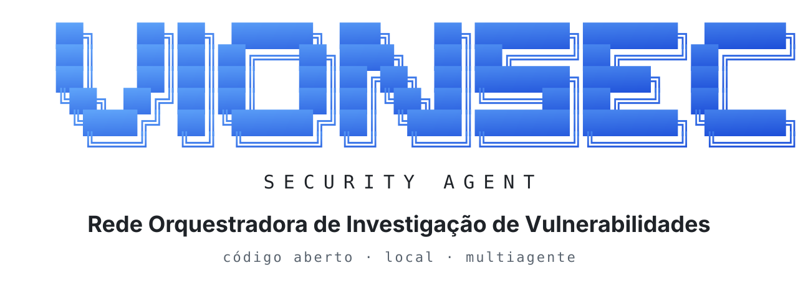

<p align="center">
  <picture>
    <source media="(prefers-color-scheme: dark)" srcset="assets/vion-banner-pt-dark.svg">
    
  </picture>
</p>

<p align="center">
  <a href="../README.md">English</a> · <b>Português</b> · <a href="README.es.md">Español</a>
</p>

# VION Security Agent

### Rede Orquestradora de Investigação de Vulnerabilidades

**Agente de segurança de código aberto para desenvolvimento assistido por IA, auditoria autônoma e investigação de vulnerabilidades baseada em evidências.**

---

## Instalação

### Requisitos

| Requisito | Versão ou condição |
|---|---|
| Node.js | 22.13 ou superior |
| Claude Code | Instalado e autenticado |
| Sistema operacional | Windows, macOS ou Linux |

Hoje o VION roda no Claude Code. O suporte a outras plataformas de agentes, como Cursor e OpenCode, está em planejamento (veja o [Roadmap](#roadmap)).

### Instalação pelo npm

```bash
npm install -g @vionsec/cli
vion init
```

### Instalação diretamente do GitHub

```bash
npm install -g github:jvncodez/VionSecurityAgent
vion init
```

O comando de inicialização configura a integração do VION com o Claude Code, incluindo as skills, os subagentes, o servidor MCP e o hook de aplicação do escopo.

Depois da instalação, reinicie o Claude Code e execute:

```bash
vion doctor
```

O diagnóstico verifica os componentes necessários para a execução.

### Desinstalação

```bash
vion uninstall
```

Consulte a documentação do comando antes de remover componentes ou dados que deseja preservar.

---

## Primeiros passos

O VION oferece três formas principais de iniciar uma auditoria.

### 1. Interface local

```bash
vion ui
```

A interface fica disponível em:

`http://localhost:3333`

Acesse a seção de auditorias para selecionar um projeto, definir o escopo autorizado e acompanhar a execução dos agentes.

Para utilizar outra porta:

```bash
vion ui --port 4000
```

### 2. Terminal

```bash
cd meu-projeto

# Auditoria completa com múltiplos agentes
vion audit .

# Apenas analisadores determinísticos
vion audit . --analyzers-only

# Executar uma skill específica
vion audit . --skills unified-scan

# Definir um limite de custo
vion audit . --max-cost 2
```

O modo `--analyzers-only` executa os analisadores suportados sem utilizar tokens de modelos de IA.

### 3. Claude Code

Dentro do Claude Code, execute:

```text
/vion:auditoria
```

A skill inicia o fluxo de auditoria integrado ao projeto.

### Consultar resultados

```bash
vion audit history
vion audit status <id>
vion report <id> --format html
```

A referência completa dos argumentos e opções fica em [`docs/COMMANDS.md`](COMMANDS.md).

---

## Sobre o projeto

O VION Security Agent é um agente autônomo de segurança que coordena uma rede hierárquica de agentes especializados para analisar aplicações, investigar vulnerabilidades e produzir relatórios baseados em evidências.

O projeto nasceu de uma pesquisa sobre segurança em aplicações desenvolvidas com inteligência artificial, especialmente os riscos introduzidos quando a velocidade de geração de código se torna prioridade em relação à validação de segurança.

O objetivo é aproximar a velocidade do desenvolvimento assistido por IA do rigor exigido pela engenharia de segurança.

- **Código aberto:** licença MIT.
- **Ambiente de execução:** Node.js 22.13+.
- **Integração:** Claude Code.
- **Arquitetura:** orquestrador, subagentes especializados e analisadores determinísticos.
- **Privacidade:** execução prioritariamente local, com banco de dados e evidências armazenados localmente.
- **Validação:** uma vulnerabilidade só é considerada confirmada quando possui evidência e método de validação registrados.

## O problema que estamos investigando

A inteligência artificial tornou possível desenvolver aplicações em uma velocidade que antes exigia equipes inteiras. Entretanto, gerar código funcional não significa necessariamente construir software seguro.

Durante nossa pesquisa, investigamos como agentes de IA lidam com requisitos de segurança, validação de código e vulnerabilidades recorrentes da OWASP Top 10.

Identificamos um problema importante: aplicações podem parecer completas e funcionar corretamente, mas ainda apresentar falhas de autorização, exposição de dados, configurações inseguras e problemas na implementação de APIs.

Entre os exemplos que motivaram o projeto estão:

- IDOR e outras falhas de controle de acesso.
- Exposição indevida de dados e informações sensíveis.
- APIs com permissões ou configurações inadequadas.
- Segredos incorporados ao código-fonte.
- Falhas de autenticação e gerenciamento de sessões.
- Vulnerabilidades em dependências e configurações de infraestrutura.
- Problemas de segurança específicos de aplicações que utilizam LLMs.

O resultado pode ser uma aplicação construída rapidamente, mas que exige meses de investigação, correções e refatoração para atingir um nível adequado de segurança.

**O VION foi desenvolvido para investigar esse gargalo.**

Em vez de tratar a segurança como uma etapa isolada ao final do projeto, propomos incorporá-la ao ciclo de vida do software: da arquitetura e implementação à auditoria, pré-produção e pós-implantação.

## Nossa abordagem

### Desenvolvimento seguro desde o início

O VION foi concebido para apoiar uma abordagem de desenvolvimento seguro desde a primeira linha de código.

Isso envolve identificar riscos antes da implementação, orientar decisões arquiteturais, verificar controles de segurança durante o desenvolvimento e auditar a aplicação antes e depois de sua implantação.

O agente também pode auxiliar na preparação de configurações básicas de infraestrutura, incluindo ambientes em Virtual Private Servers (VPS), de acordo com o escopo e as necessidades do projeto.

A proposta não é substituir desenvolvedores, engenheiros de segurança ou processos de QA. É fornecer uma camada adicional de análise e investigação que ajude a reduzir falhas evitáveis.

## A pesquisa

A principal pergunta da pesquisa é:

> Uma rede hierárquica de agentes de IA consegue auditar software com rigor, evidências verificáveis e menor consumo de tokens do que uma abordagem baseada em um único agente?

A arquitetura atual explora três hipóteses.

**1. Análise determinística antes da análise por IA**

Analisadores estáticos verificam padrões conhecidos, como segredos expostos, fluxos de dados potencialmente perigosos, configurações de infraestrutura, uso de criptografia e possíveis falhas de autorização.

Essas verificações não dependem de tokens de modelos de linguagem e ajudam a reservar a análise por IA para tarefas que exigem mais contexto.

**2. Especialização e hierarquia de agentes**

Um modelo de maior capacidade planeja a auditoria, distribui tarefas e revisa os resultados. Subagentes especializados executam checklists de segurança em paralelo, investigando diferentes partes da aplicação.

Essa divisão busca reduzir contexto redundante e tornar o processo mais eficiente.

**3. Evidência obrigatória para confirmação**

Todo achado começa como suspeita. Para ser confirmado, precisa apresentar evidência associada e um método de validação documentado.

Quando a evidência não é suficiente, o achado não deve ser apresentado como vulnerabilidade confirmada.

### Resultado experimental

Em uma auditoria de um projeto de teste deliberadamente vulnerável, a configuração experimental utilizada confirmou 13 achados com evidências em aproximadamente 3,5 minutos, com custo reportado de US$ 0,89.

Nessa execução, o orquestrador baseado em Opus representou aproximadamente 55% do custo, enquanto os subagentes representaram o restante.

Esses números descrevem uma execução específica, não uma garantia de desempenho, cobertura ou custo para qualquer aplicação. A pesquisa busca ampliar a validação em diferentes projetos e cenários e, além dos agentes do Claude Code, em outras plataformas de agentes.

---

## Como funciona

O VION combina análise determinística, planejamento, investigação paralela, validação de evidências, correlação de resultados e geração de relatórios.

O fluxo geral é:

1. O usuário inicia uma auditoria pela CLI, pela interface local ou pelo Claude Code.
2. O motor verifica o escopo e as permissões aplicáveis.
3. Os analisadores determinísticos executam as verificações suportadas.
4. O orquestrador divide o trabalho entre os agentes especializados.
5. Os subagentes investigam diferentes categorias de vulnerabilidades.
6. O agente investigador valida as suspeitas e registra as evidências.
7. O motor correlaciona os resultados e trata duplicatas.
8. O orquestrador realiza a revisão final.
9. O agente de relatórios organiza os resultados para análise técnica e executiva.

<p align="center">
  <picture>
    <source media="(prefers-color-scheme: dark)" srcset="assets/vion-flow-pt-dark.svg">
    
  </picture>
</p>

Os resultados são armazenados localmente e podem ser consultados pela interface ou exportados em formatos como HTML, Markdown e JSON.

### Agentes especializados

| Agente | Responsabilidade |
|---|---|
| Orquestrador | Planeja, delega tarefas e revisa os resultados críticos. |
| `vion-recon` | Identifica a stack tecnológica, os ativos e a superfície de ataque. |
| `vion-vuln` | Executa checklists especializadas de vulnerabilidades. |
| `vion-threat-intel` | Investiga dependências, CVEs e GHSA. |
| `vion-investigador` | Avalia suspeitas, evidências e métodos de validação. |
| `vion-correlacao` | Identifica duplicatas e conflitos entre achados. |
| `vion-relatorio` | Produz o resumo executivo e organiza os resultados. |

Os modelos associados a cada função são configuráveis. A configuração padrão utiliza Opus no orquestrador, Sonnet nas tarefas de investigação e Haiku em funções auxiliares.

### Ciclo de vida dos achados

`Suspeito → Confirmado`

`Suspeito → Falso positivo`

A confirmação exige evidência e um método de validação documentado. Um resultado sem evidência suficiente permanece sem confirmação, independentemente da confiança expressa pelo modelo.

### Eficiência de contexto e custos

A arquitetura busca reduzir o consumo de tokens por meio de:

- Divisão das tarefas em checklists especializadas.
- Compartilhamento de identificadores de auditoria e tarefas pelo MCP.
- Uso de resumos e identificadores de achados no lugar de grandes blocos de código no contexto do orquestrador.
- Deduplicação por impressões digitais dos achados.
- Limites de custo configuráveis para interromper a execução.

A eficiência depende do projeto, dos modelos utilizados, da quantidade de código analisado e das tarefas necessárias.

---

## Comandos

O VION utiliza `vion help` como ponto central de consulta à documentação da CLI.

```bash
vion help
vion help audit
```

A ajuda geral apresenta os comandos disponíveis. A ajuda específica detalha o uso, as opções e os exemplos do comando solicitado.

| Comando | Finalidade |
|---|---|
| `vion help` | Exibe a ajuda geral da CLI. |
| `vion help <comando>` | Mostra a documentação de um comando específico. |
| `vion init` | Instala e configura a integração com Claude Code. |
| `vion ui` | Inicia a interface web local. |
| `vion audit <alvo>` | Inicia uma auditoria autorizada. |
| `vion audit history` | Lista auditorias anteriores. |
| `vion audit status <id>` | Consulta o andamento e os custos de uma auditoria. |
| `vion report <id>` | Gera ou exporta um relatório. |
| `vion agents list` | Lista os agentes e seus modelos configurados. |
| `vion skills list` | Lista as skills disponíveis. |
| `vion skills show <nome>` | Explica uma skill e seus requisitos. |
| `vion config get` | Consulta as configurações. |
| `vion config set <chave> <valor>` | Altera uma configuração suportada. |
| `vion doctor` | Diagnostica a instalação. |
| `vion data backup` | Cria um backup dos dados locais. |
| `vion data export <id>` | Exporta os dados de uma auditoria. |
| `vion data prune` | Remove dados conforme os critérios configurados. |
| `vion uninstall` | Remove a integração instalada pelo VION. |

Os argumentos exatos, as opções adicionais e os exemplos de uso devem ser consultados por meio de `vion help` e da documentação correspondente.

---

## Skills do VION

As skills especializam o comportamento do agente de acordo com a tarefa. Cada uma deve ter uma finalidade clara, critérios de utilização e permissões compatíveis com sua responsabilidade.

| Categoria | Skills |
|---|---|
| Orientação | `/vion`, `/vion:ajuda`, `/vion:ciclo` |
| Desenvolvimento seguro | `/vion:novo`, `/vion:dev-seguro` |
| Auditoria | `/vion:auditoria`, `/vion:orquestrar`, `/vion:unified-scan` |
| Pentest e correção | `/vion:pentester`, `/vion:pentest`, `/vion:corrigir`, `/vion:fixes` |
| Aprendizado e diagnóstico | `/vion:ensinar`, `/vion:debug` |
| Reconhecimento e inteligência | `/vion:recon`, `/vion:supply-chain` |
| Segurança de IA | `/vion:ai` |
| Pré-produção e operação | `/vion:pre-deploy`, `/vion:monitorar`, `/vion:incidente` |
| Privacidade | `/vion:lgpd` |
| Utilidades | `/vion:landing`, `/vion:status` |

Para entender uma skill, consulte:

```bash
vion skills show <nome>
```

A documentação deve explicar o propósito da skill, os cenários de uso, os agentes envolvidos e as permissões necessárias.

---

## Interface web local

A interface permite acompanhar o ciclo de vida das auditorias sem depender exclusivamente do terminal.

| Página | Funcionalidade |
|---|---|
| Início | Indicadores, severidades e auditorias recentes. |
| Auditorias | Criação, acompanhamento e interrupção das execuções. |
| Agentes | Atividades, modelos, tokens, custos e duração. |
| Vulnerabilidades | Triagem dos achados suspeitos, confirmados e descartados. |
| Evidências | Trechos de código e resultados que fundamentam os achados. |
| Relatórios | Exportação em HTML, Markdown e JSON. |
| Skills e configurações | Consulta das skills, dos modelos e dos limites operacionais. |

As evidências podem incluir hashes de integridade para ajudar a detectar alterações posteriores.

A interface é destinada ao acesso local, sem um sistema de login próprio. Por isso, sua exposição a outras máquinas deve ser evitada.

---

## Segurança e uso responsável

O VION é destinado à auditoria e à investigação de segurança em projetos próprios ou em sistemas para os quais exista autorização adequada.

### Controles previstos na arquitetura

- **Escopo:** o motor aplica as restrições de auditoria, com apoio de hooks e verificações de permissões.
- **Testes ativos:** exigem autorização e escopo compatíveis com as operações executadas.
- **Leitura e escrita:** as operações são limitadas conforme o modo de execução e as permissões definidas.
- **Proteção de segredos:** tokens e senhas devem ser mascarados antes de serem armazenados ou incluídos nos relatórios.
- **Isolamento local:** a interface deve permanecer vinculada a `127.0.0.1`, com proteções contra ataques aplicáveis ao servidor web local.
- **Instruções maliciosas no código:** conteúdo encontrado durante a auditoria deve ser tratado como dado não confiável, não como instrução para os agentes.

A efetividade desses controles depende de sua implementação e validação. Consulte [`SECURITY.md`](../SECURITY.md) para conhecer o modelo de ameaças, as limitações e os procedimentos de reporte responsável.

---

## Privacidade e armazenamento

O VION utiliza armazenamento local para manter o histórico de auditorias, as evidências, os relatórios, os logs e as configurações.

| Sistema | Diretório padrão |
|---|---|
| Windows | `%LOCALAPPDATA%\vion` |
| macOS | `~/Library/Application Support/vion` |
| Linux | `$XDG_DATA_HOME/vion` ou `~/.local/share/vion` |

A variável `VION_HOME` permite configurar outro diretório de armazenamento.

Exemplos:

```bash
# Criar backup
vion data backup

# Exportar uma auditoria
vion data export <id>

# Remover auditorias antigas
vion data prune --older-than 90

# Configurar retenção
vion config set retention.days 180
```

O projeto foi concebido para não enviar dados a servidores próprios. Os recursos de IA dependem da integração com o Claude Code e do processamento realizado pelo provedor de modelo utilizado. Portanto, o armazenamento local não significa que o código nunca será transmitido para serviços externos durante uma análise com IA.

Os analisadores determinísticos podem funcionar sem chamadas a modelos de linguagem. Os requisitos de conectividade e as condições de privacidade de cada modo devem ser consultados na documentação.

---

## Roadmap

### Suporte a outras plataformas de agentes

Esta pesquisa não vai parar nos agentes do Claude Code. A pergunta que o VION investiga vale para qualquer agente de IA que escreve ou revisa código, e queremos medir os resultados em diferentes plataformas e modelos.

Hoje o VION se integra ao Claude Code. Já estamos planejando o suporte a outras plataformas de agentes, como **Cursor** e **OpenCode**, para que as mesmas skills, agentes especializados, aplicação de escopo e armazenamento local funcionem independentemente da ferramenta que a equipe utiliza.

O objetivo é manter o motor (analisadores determinísticos, armazenamento de evidências, escopo e relatórios) independente da plataforma de agentes, com uma camada de integração para cada uma.

Se você usa uma dessas plataformas e quer ajudar, abra uma issue para discutir a integração.

---

## Contribuindo

O VION é um projeto de código aberto de pesquisa e engenharia de segurança. Contribuições são bem-vindas para ampliar a cobertura de análise, melhorar a precisão das investigações e tornar a arquitetura mais eficiente.

Alguns pontos de partida:

- `assets/checklists/`: novas checklists e melhorias de cobertura.
- `assets/skills/`: novas skills e melhorias nas existentes.
- `src/analyzers/`: analisadores determinísticos.
- Agentes e orquestração: melhorias de especialização, validação e consumo de contexto.
- Testes: projetos de referência, casos reproduzíveis e avaliação de falsos positivos.

Antes de contribuir, consulte [`CONTRIBUTING.md`](../CONTRIBUTING.md).

Falhas de segurança no próprio VION devem ser reportadas de maneira privada, conforme as instruções de [`SECURITY.md`](../SECURITY.md).

Repositório: [github.com/jvncodez/VionSecurityAgent](https://github.com/jvncodez/VionSecurityAgent)

## Licença

O VION Security Agent é distribuído sob a licença MIT. Consulte o arquivo [`LICENSE`](../LICENSE) para conhecer os termos de utilização, modificação e redistribuição.

Utilize a ferramenta somente em ambientes próprios ou com autorização adequada.

---

<p align="center">
  <b>VION Security Agent</b><br>
  <b>Desenvolva mais rápido. Investigue mais a fundo. Construa com segurança.</b><br>
  Um projeto de código aberto dedicado à pesquisa de agentes autônomos de segurança, validação baseada em evidências e desenvolvimento seguro de aplicações com inteligência artificial.
</p>
